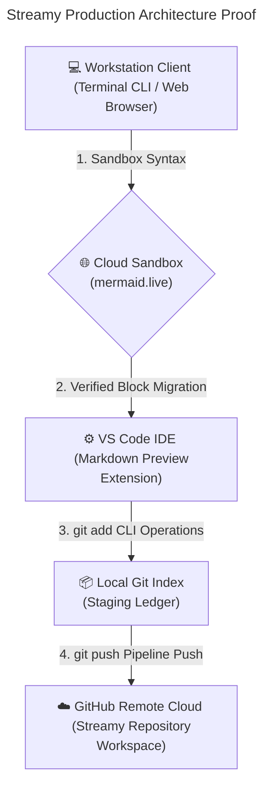
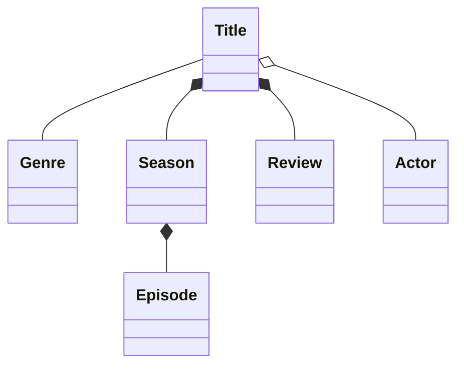

# Streamy Video Streaming Backend Platform
## Software Technology Course Laboratory Node
* **Student Identity:** [填入你的姓名]
* **Neptun System Code:** [填入你的 Neptun 代码]
* **Course Section Reference:** GEIAL314-B2a
---
## Workspace Environment Architecture
The diagram below maps out how our development environment connects local code authoring to remote version tracking, using a **Diagrams-as-Code** design pipeline.


## Domain Model (UML Class Diagram)


## Domain Model (UML Class Diagram)

```mermaid
---
title: Streamy Domain Model
---
classDiagram
    Title: \n\n
    link Title "[https://example.com/titles](https://example.com/titles)" _blank
    
    %% Relationships with Multiplicity, Direction, and Labels
    Title "1..*" -- "1..*" Genre: is associated with
    Title "1" *-- "0..*" Season: has
    Title "1" *-- "0..*" Review: has
    Title "0..*" o-- "1..*" Actor: features
    
    %% Generalization / Inheritance
    TVShow --> Title: implements
    Short --> Title: implements
    Film --> Title: implements
    
    Viewer "0..*" --> "0..*" Title: watches
    Season "1" *-- "0..*" Review: has
    Season "1" *-- "1..*" Episode: contains
    Episode "1" *-- "0..*" Review: has